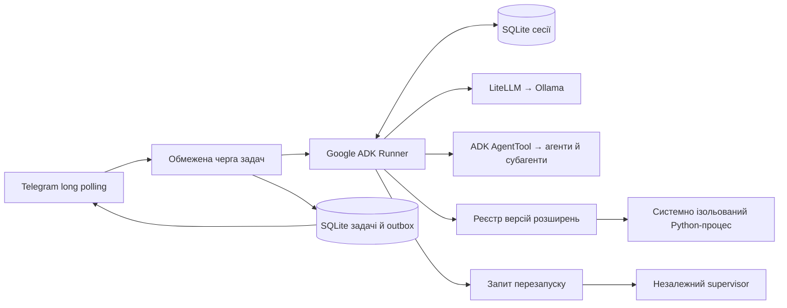

# T-Bot

Telegram-бот на Python із Google ADK та локальною Ollama. Типова модель — `gemma4:12b`.
Бот підтримує постійні сесії, фонові задачі, самоперезапуск, створення Python-інструментів,
ADK-агентів і субагентів за запитом користувача. Docker не використовується.

## Встановлення

Потрібні Python 3.12–3.14, [uv](https://docs.astral.sh/uv/),
[Ollama](https://ollama.com/) та Telegram-бот, створений через `@BotFather`.
Перевірений шлях ізоляції — macOS із `/usr/bin/sandbox-exec`.
Для Linux реалізовано backend через `bubblewrap`; він потребує дозволених user namespaces
та окремої перевірки `doctor` на вашому дистрибутиві. Windows не підтримується.

```sh
uv sync --frozen --python 3.12
ollama pull gemma4:12b
cp .env.example .env
```

Заповніть `.env`:

```dotenv
TELEGRAM_BOT_TOKEN=токен_від_BotFather
ALLOWED_USER_IDS=[ваш_числовий_Telegram_user_ID]
OLLAMA_BASE_URL=http://127.0.0.1:11434
DEFAULT_MODEL=gemma4:12b
```

`ALLOWED_USER_IDS` — JSON-масив числових ID користувачів, а не username чи ID групи.
Порожнє значення `ALLOWED_USER_IDS=` або `ALLOWED_USER_IDS=[]`, а також відсутність цього
параметра дозволяють доступ усім користувачам, включно з адміністративними діями.
Дізнатися власний ID можна через Telegram API або довірений Telegram-клієнт/бот для показу ID.
Якщо список заповнений, доступ мають лише перелічені користувачі з адміністративними правами
на моделі, розширення та перезапуск.
Їхня історія діалогу й задачі ізольовані за парою user ID + chat ID; каталог розширень і вибір
моделей спільні для адміністратора/адміністраторів цієї інсталяції.

Ollama має бути запущена: через застосунок Ollama або `ollama serve`.
Бот не завантажує моделі автоматично й не замінює модель без вашого запиту.

```sh
uv run t-bot doctor
./start
```

Файл `start` запускає supervisor через локальне середовище `.venv` та автоматично переходить
у корінь проєкту. Альтернативна команда запуску — `uv run t-bot run`.

`doctor` перевіряє Ollama, типову модель, системну ізоляцію та наявність конфігурації Telegram.
Токен перевіряється через `getMe` під час запуску бота. Якщо типова модель тимчасово відсутня,
Telegram-команди залишаються доступними для її зміни. Якщо ізоляція недоступна, розширення
не запускаються; виконання без sandbox не передбачене.

Запускайте з кореня репозиторію, де розташований `.env`. `run` запускає supervisor і дочірній
worker. `worker` існує для діагностики; самоперезапуск у цьому режимі вимкнений.

## Команди Telegram

| Команда | Призначення |
| --- | --- |
| `/start`, `/help` | Повний гайд: команди, базові інструменти й активні розширення з прикладами |
| `/status` | Стан Ollama, моделі, черги й останніх задач |
| `/models` | Установлені моделі Ollama |
| `/model MODEL [AGENT_ID]` | Зберегти модель для `root` або окремого агента |
| `/agents`, `/tools` | Активні агенти або інструменти |
| `/extensions` | Усі невидалені версії розширень |
| `/source ID [VERSION]` | Маніфест і Python-код розширення |
| `/extension enable ID VERSION` | Активувати перевірену версію |
| `/extension disable ID` | Вимкнути розширення |
| `/extension rollback ID VERSION` | Повернутися до попередньої версії |
| `/extension delete ID` | Прибрати розширення з реєстру; файли версій зберігаються для аудиту |
| `/cancel TASK_ID` | Скасувати власну задачу в поточному чаті |
| `/new` | Нова сесія, коли в чаті немає незавершених задач |
| `/restart` | Керований самоперезапуск |
| `/screenshot` | Скріншот екрана комп’ютера бота в поточний чат |
| `/time` | Поточні дата, час і часовий пояс |

Звичайні повідомлення обробляє ADK-агент. Наприклад:

- «Створи інструмент word_count: приймай text, повертай JSON з кількістю слів».
- «Створи агента writer для написання українських текстів».
- «Створи субагента editor з батьком writer для редагування тексту».
- «Створи для writer інструмент підрахунку символів».
- «Покажи встановлені моделі та зміни модель агента editor на MODEL зі списку».
- «Онови word_count: додай підрахунок символів» — нова перевірена версія того самого ID.
- «Перезапусти себе зі збереженням діалогу».

Нові розширення та зміни моделей підключаються з наступного повідомлення.
Перш ніж вимикати батьківського агента, вимкніть його активних нащадків.
Моделі для діалогу повинні підтримувати completion; для викликів інструментів потрібна
сумісна реалізація tool calling. Embedding-моделі відхиляються.

## Базові інструменти

Головному агенту й усім ADK-субагентам автоматично доступні:

| Інструмент | Можливість |
| --- | --- |
| `list_files(path=".")` | Перегляд каталогу: імена, типи й розміри, до 100 записів |
| `read_file(path, offset=0, limit=12000)` | Читання UTF-8 тексту частинами за символьним offset |
| `write_file(path, content)` | Створення або атомарна заміна файлу |
| `create_directory(path)` | Створення папки та відсутніх батьківських папок |
| `delete_file(path)` | Видалення звичайного файлу; каталоги не видаляються |
| `search_web(query, max_results=5)` | Пошук в інтернеті: назви, URL та короткі описи |
| `list_databases()` | Службові та користувацькі SQLite-бази |
| `create_database(name)` | Створення нової бази без перезапису існуючої |
| `database_schema(database)` | Таблиці, view, індекси, тригери та їхній SQL |
| `table_schema(database, table)` | Колонки, ключі, індекси й зовнішні ключі таблиці |
| `execute_sql(database, sql, parameters_json="[]", max_rows=100)` | Один SQL-запит із результатами |
| `execute_sql_script(database, sql)` | SQL-скрипт для користувацької бази |
| `run_command(command, cwd=".", timeout_seconds=0)` | Консоль: stdout, stderr, exit code, таймаут |
| `take_screenshot()` | «Що на екрані»: захоплення й відправлення скріншота в чат |
| `get_current_datetime()` | «Котра година» / «Скока время»: поточна дата й час |

Перегляд через Telegram — `/tools`; виклики — звичайними повідомленнями:

- «Покажи файли в робочому каталозі».
- «Створи папку notes, запиши hello.txt із текстом Привіт і прочитай його».
- «Знайди документацію Python pathlib в інтернеті та наведи посилання».
- «Знайди інформацію про Google ADK і збережи короткий огляд у notes/adk.txt».

Файли зберігаються в `FILESYSTEM_ROOT` (типово `./workspace`) між викликами й перезапусками.
Шляхи відносні до цього каталогу; абсолютні шляхи дозволені лише всередині нього.
Файловий каталог спільний для користувачів із доступом до бота. За порожнього
`ALLOWED_USER_IDS` ці інструменти, включно із записом та видаленням, доступні всім.
Ліміт читання/запису — `FILESYSTEM_MAX_FILE_BYTES` (типово 262144 байти).
Перед записом у вкладену папку агент має створити її через `create_directory`.
Символьні посилання не розкриваються; вихід за межі каталогу, `.env*`, службові каталоги,
бази стану, реєстр розширень, код бота й Python runtime недоступні файловим інструментам.

Web-пошук не потребує API-ключа: використовується DDGS (DuckDuckGo/Brave/Yahoo),
а якщо основні backend-и не повернули результатів — резервний Bing RSS.
`WEB_SEARCH_TIMEOUT_SECONDS` задає таймаут звернення до пошукового сервісу, а
`WEB_SEARCH_MAX_RESULTS` — максимальну кількість результатів (1–10, типово 10).
Провайдер може обмежувати запити; у такому разі інструмент повертає помилку, а не вигадані
результати. Результат містить назву фактично використаного backend-а.
Запит надсилається зовнішнім пошуковикам; вміст локальних файлів автоматично не передається.
Інструмент повертає пошукові описи, без завантаження повного тексту знайдених сторінок.

Це довірені інструменти процесу бота з окремою авторизацією та аудитом. Згенерований Python-код
виконується в системному sandbox із доступом до FILESYSTEM_ROOT та інтернету
за замовчуванням, незалежно від поля permissions.
ADK-агент може користуватися базовими інструментами через свої tool calls.

### SQLite: службові та користувацькі бази

`list_databases` показує `state` (`DATA_DIR/state.sqlite3`), `session`
(`DATA_DIR/sessions.sqlite3`) і бази з `SQLITE_DATABASE_DIR`.
За замовчуванням цей каталог — `DATA_DIR/databases`. У ньому знаходяться створені агентом бази;
наявні власні SQLite-файли можна також розмістити в цьому каталозі.
Назви користувацьких баз — прості імена файлів, наприклад `notes.db` або `shop.sqlite3`.
Каталог і бази спільні для користувачів із доступом до бота.

`state` і `session` **завжди read-only** для SQL-інструментів: дозволені `SELECT`, читальні
`PRAGMA` й перегляд структури. З’єднання відкривається через SQLite URI `mode=ro`, вмикає
`query_only` та authorizer, який відхиляє зміни, DDL і зміну налаштувань. Звичайний код бота
продовжує записувати сесії та стан через власні з’єднання.

Користувацькі бази мають **повний SQL-доступ усередині вибраної бази**: `SELECT`, `INSERT`,
`DELETE`, `UPDATE`, `CREATE`, `ALTER`, `DROP`, view, індекси, тригери, звичайні `PRAGMA`,
`VACUUM`, `RETURNING` і SQL-скрипти. Власні запити не обмежуються списком CRUD-команд.
Не дозволені підключення сторонніх файлів через `ATTACH`, `VACUUM INTO`, завантаження
розширень і процес-глобальні `PRAGMA`, щоб SQL однієї бази не міг змінити службові бази
чи налаштування всього процесу. Символьні й жорсткі посилання на службові бази не дають RW-доступу.

`execute_sql` приймає один statement. Для параметрів використовуйте JSON-масив для `?`
або JSON-об’єкт для `:name`: наприклад `parameters_json='["Привіт"]'`.
Кожний виклик має окреме з’єднання й фіксує успішні зміни. Для кількох команд та спільної
транзакції використовуйте `execute_sql_script` із `BEGIN; ... COMMIT;`.
Якщо скрипт не містить `BEGIN`, попередні команди можуть лишитися зафіксованими при помилці
в наступній команді. Відкрита транзакція при помилці відкочується.

`SQLITE_QUERY_TIMEOUT_SECONDS` (типово 5) обмежує виконання SQL через progress handler;
`SQLITE_MAX_ROWS` (типово 100, максимум 1000) — кількість рядків результату. Великі результати
обмежені також за обсягом і позначаються `truncated`; для перегляду решти використовуйте
`LIMIT`/`OFFSET`. BLOB повертається як base64, довгі значення — з ознакою обрізання.
Скрипти повертають кількість змін, а не результати всіх `SELECT`.

Приклади повідомлень агенту:

- «Покажи існуючі SQLite-бази та їхні режими доступу».
- «Покажи структуру бази state і таблиці jobs».
- «Прочитай останні 10 записів jobs із state, нічого не змінюй».
- «Створи базу notes.db, таблицю notes, додай текст Привіт і прочитай його».
- «Онови запис у notes.db, потім видали його й перевір результат».

### Консольні команди

`run_command` запускає неінтерактивну команду через `/bin/sh -c`. Підтримуються pipes,
перенаправлення, послідовності команд і встановлені консольні програми. Наприклад:

- «Виконай у консолі `pwd` та `ls -la`».
- «Виконай `python --version` і поверни stdout та код завершення».
- «Відсортуй рядки: `printf 'beta\nalpha\n' | sort > sorted.txt; cat sorted.txt`».
- «Перевір заголовки сторінки: `curl -I https://example.com`».

`cwd` — каталог усередині `FILESYSTEM_ROOT`; типово це корінь робочого каталогу.
Команда має мережевий доступ і може змінювати файли у робочому каталозі та власному
тимчасовому сховищі. Системна ізоляція macOS/bubblewrap захищає службові бази, код бота
та Python-середовище від запису. Оточення бота й Telegram-токен не передаються; `HOME` і
`TMPDIR` вказують на окрему тимчасову папку. stdin закритий: інструмент не призначений для
інтерактивних програм, запиту паролів, демонів або постійних серверів.
Зміни робочих файлів зберігаються; зупинка команди не скасовує вже виконаних записів.

`CONSOLE_TIMEOUT_SECONDS` (типово 30) — таймаут за замовчуванням і максимальний дозволений
таймаут виклику. `timeout_seconds=0` обирає це значення. При таймауті або скасуванні завершується
група процесів команди. Після завершення також прибираються фонові процеси цієї групи.
`CONSOLE_MAX_OUTPUT_BYTES` (типово 6000) обмежує кожен потік виводу; зайвий вивід відкидається,
а відповідний `stdout_truncated`/`stderr_truncated` стає `true`.

Результат містить `stdout`, `stderr`, `exit_code`, `timed_out`, ознаки обрізання та `cwd`.
Ненульовий код завершення повертається без приховування stderr. Команди не повторюються
автоматично. В аудит потрапляють користувач і робочий каталог; команда та її вивід у журнал
не записуються. За порожнього `ALLOWED_USER_IDS` інструмент доступний усім користувачам.
Для перезапуску бота використовується `restart_bot`, для SQLite — відповідні SQL-інструменти.

### «Що зараз на екрані» / «Що на екрані»

Надішліть **«Що зараз на екрані»**, **«Що на екрані?»** або `/screenshot` — бот створить
скріншот комп’ютера, на якому він запущений, і відправить його в той самий Telegram-чат.
Регістр, зайві пробіли й кінцева пунктуація не впливають на ці дві фрази. Вони виконуються
напряму без запиту до Ollama. Для інших формулювань головному агенту й субагентам доступний
ADK-інструмент `take_screenshot` без аргументів: одержувач береться з контексту запиту.

На macOS використовується системний `screencapture` для основного монітора. У налаштуваннях
конфіденційності надайте **дозвіл на запис екрана** терміналу або IDE, що запускає бота,
за потреби додайте застосунок до списку та перезапустіть його й бота. Бот не обходить системні
дозволи й повідомляє, якщо доступ відсутній. На Linux потрібен активний графічний сеанс і
системна утиліта `grim` для сумісного Wayland-композитора, `scrot` для X11 або `gnome-screenshot`.
Утиліти беруться із системних `/usr/bin` чи `/bin`, а не з робочого каталогу.
На headless-сервері без доступного дисплея захоплення не працюватиме.

Зображення відправляється як фото; якщо його розміри або обсяг не підходять для `sendPhoto`,
надсилається PNG-документ. Тимчасовий файл видаляється після захоплення; саме зображення
не потрапляє до SQLite, текстових журналів або історії ADK/LLM. Інструмент повертає лише статус
відправлення, ID повідомлення й розміри. Це захоплення екрана, без автоматичного аналізу його вмісту.

`SCREENSHOT_TIMEOUT_SECONDS` (типово 10) задає таймаут захоплення, `SCREENSHOT_MAX_BYTES`
(типово 20 MB, максимум 50 MB) — ліміт PNG. При невизначеній мережевій помилці бот не робить
повторний знімок і не повторює відправлення автоматично. Повторний update з тим самим ID
не спричиняє ще одне захоплення. За порожнього `ALLOWED_USER_IDS` інструмент доступний усім.

### «Котра година» / «Скока время»

Фрази **«Котра година»**, **«Скока время»** та команда `/time` повертають поточну дату,
час із секундами, часовий пояс і UTC-зсув. Вони обробляються напряму без виклику Ollama;
регістр, зайві пробіли й кінцева пунктуація не впливають на розпізнавання.

Час береться із системного годинника комп’ютера бота. Типовий часовий пояс — `Europe/Kyiv`;
змінити його можна через `BOT_TIMEZONE` у `.env`, наприклад на `UTC` або `America/New_York`.
Використовуються IANA time zones з автоматичним переходом на літній/зимовий час.
Головному агенту й субагентам доступний `get_current_datetime()`, що повертає також ISO 8601.

## Як це працює



- Telegram-адаптер перевіряє доступ до приймання задачі; адміністративні інструменти повторно
  перевіряють user ID із контексту виконання, а не з аргументів моделі.
- Повідомлення одного користувача в одному чаті виконуються послідовно. Кількість workers,
  місткість черги, час задачі, кількість LLM-кроків і розмір контексту обмежені конфігурацією.
- ADK `DatabaseSessionService` зберігає історію в `data/sessions.sqlite3`, задачі, аудит,
  моделі й реєстр — у `data/state.sqlite3`. Скасовані й перервані задачі не повторюються автоматично.
- Telegram update ID зберігається до виконання, тому повторна доставка update не запускає дію
  вдруге. Це семантика **не більше одного виконання**: після аварії невизначену операцію треба
  перевірити й за потреби повторити новим повідомленням. Вихідні повідомлення мають повторну
  доставку з outbox; збій після надсилання може спричинити дубль повідомлення, але не дії агента.
- Supervisor тримає окремий lock, запускає лише одного worker і обмежує часті падіння.
  Worker зберігає запит перезапуску, припиняє polling, завершує або скасовує задачі й виходить
  із кодом 75. Новий worker перевіряє Telegram, ADK/SQLite та Ollama й надсилає результат.

## Контракт та ізоляція розширень

Розширення має `extension.py` і `manifest.json`, ID, версію, тип, точку входу, модель,
батьківського агента, залежності, дозволи, JSON-схеми входу/виходу, приклад входу й опис використання.
Приклади готових файлів наведено в `examples/`.

Інструмент реалізує `invoke(payload: dict) -> dict` із docstring. Під час перевірки він
виконується на `example`, а результат перевіряється за `output_schema`.
Агент реалізує `build_agent(model: str, api_base: str) -> LlmAgent` із `LiteLlm`.
Підтриманий формат агента — декларативна роль: `name`, `description`, `instruction`, `model`.
Субагенти й інструменти приєднуються через поле `parent` у маніфесті, а не виконувані callbacks.

Код генерується через JSON API Ollama з JSON Schema та `think=false`. Синтаксис, маніфест,
імпорти, фабрика ADK і приклад інструмента перевіряються до активації. Згенеровані модулі
ніколи не імпортуються в процес бота: фабрика ADK виконується в sandbox, звідки повертає лише
обмежений опис; довірений код складає з нього ADK-граф. Інструменти щоразу виконуються в sandbox.

На macOS використовується профіль Seatbelt із забороною за замовчуванням; на Linux —
відокремлені namespaces bubblewrap. Дозволено читати Python runtime, встановлені бібліотеки,
копію поточної версії та мінімальні системні файли. Секрети, `.env`, база стану,
довільні файли хоста й створення дочірніх процесів недоступні.
Інтернет та DNS доступні всім extensions за замовчуванням.
Оточення очищується. Усі розширення за замовчуванням мають доступ до постійного
`FILESYSTEM_ROOT` для читання й запису. Шлях доступний через
`os.environ["FILESYSTEM_ROOT"]`; робочий каталог розширення також є `FILESYSTEM_ROOT`.
Тому `open("example.txt")` читає `workspace/example.txt` із проєкту за типової конфігурації.
Не додавайте префікс `workspace/` до шляху всередині розширення: він уже працює в цьому каталозі.
Можна передати абсолютний шлях усередині FILESYSTEM_ROOT. Файли зберігаються між викликами
й доступні базовим файловим інструментам, зокрема `send_file`.
Доступ працює також для наявних маніфестів із `permissions: []` або без цього поля.
Тимчасові файли створюйте в `TMPDIR`. Довільний shell недоступний.
Мережевий доступ увімкнено за замовчуванням.

У Python використайте:

```python
import os
from pathlib import Path

root = Path(os.environ["FILESSYSTEM_ROOT"])
(root / "report.txt").write_text("Результат", encoding="utf-8")
```

Змінювати маніфести вже встановлених розширень не потрібно; перезапустіть бота.
`FILESYSTEM_ROOT` має бути окремим робочим каталогом, який не перетинається з кодом,
Python-середовищем, DATA_DIR або EXTENSIONS_DIR. При перетині запуск розширення
завершиться зрозумілою помилкою. Секрети `.env*`, службові каталоги та наявні hardlink
у робочому каталозі приховуються; посилання не відкривають доступу до сторонніх файлів.
При валідації виконується приклад із маніфесту, тому він також може змінювати робочі файли:
приклади мають створювати власні файли й не перезаписувати дані користувача.

Є ліміти CPU, wall time, розміру файлу (4 MiB), виводу (128 KB на канал), відкритих дескрипторів
і пам’яті. На macOS пам’ять перевіряється за RSS кожні 100 мс, тому можливе коротке перевищення
до завершення процесу; на Linux додатково встановлено `RLIMIT_AS`. `sandbox-exec` — системний
інструмент macOS, позначений Apple як deprecated: сумісність із новими macOS перевіряйте `doctor`
та sandbox-тестами. Непідтримана платформа завершує операцію з помилкою.

Додаткові пакети дозволяє оператор у `.env`, наприклад `ALLOWED_DEPENDENCIES=["package==version"]`.
Порожнє значення `ALLOWED_DEPENDENCIES=`, список `[]` або відсутність параметра дозволяють
будь-які пакети. Заповнений список дозволяє лише перелічені залежності.
У списку дозволів версії мають бути точними й зафіксованими, без URL або pip options.
Для встановлення можна вказати основні назви пакетів: pip resolver автоматично знаходить
транзитивні залежності, а код перевіряє весь набір дозволів і зберігає точні версії в маніфесті.
Встановлюються лише wheels, без source builds. За заповненого `ALLOWED_DEPENDENCIES`
транзитивні пакети також мають бути в цьому списку. Вони зберігаються окремо в
`data/dependencies/` і додаються до шляху імпорту лише ізольованого процесу. Версії основного
середовища ADK/бота розширення змінювати не повинні.

Активація версії атомарна на рівні реєстру. Попередня версія зберігається; невдала перевірка
не змінює активну. Контрольна сума не дозволяє непомітно виконати відредагований після перевірки
інструмент. Файли неактивних версій не виконуються. Якість згенерованої бізнес-логіки перевіряйте
прикладами своїх задач: проходження контракту саме по собі не доводить правильність алгоритму.

## Зупинка, журнали та резервні копії

У foreground — `Ctrl+C`. З іншого термінала в тому самому каталозі:

```sh
uv run t-bot stop
```

Журнали пишуться JSON-рядками в stderr без текстів промптів, аргументів інструментів і токенів.
Для збереження: `uv run t-bot run 2>>bot.log`.
Аудит адміністративних дій і викликів розширень міститься в таблиці `audit` SQLite.

Для узгодженої резервної копії спочатку зупиніть бота й дочекайтеся завершення `run`:

```sh
uv run t-bot stop
uv run t-bot backup backups/snapshot-001
```

Команда відмовить, якщо worker ще працює. Копія містить обидві SQLite-бази та всі версії
розширень. `.env` зберігайте окремо. Після відновлення дозволені залежності відтворюються з PyPI.
Робочі файли `FILESYSTEM_ROOT` копіюйте окремо: команда `backup` зберігає стан бота та розширення.
Користувацькі SQLite-бази з `SQLITE_DATABASE_DIR` також копіюйте окремо після зупинки бота;
вони не входять до копії службових баз.

Приклад відновлення для стандартних `DATA_DIR` та `EXTENSIONS_DIR` (бот має бути зупинений):

```sh
mv data data.before-restore
mkdir -m 700 data
cp backups/snapshot-001/state.sqlite3 data/
cp backups/snapshot-001/sessions.sqlite3 data/
cp -R backups/snapshot-001/extensions data/extensions
uv run t-bot doctor
uv run t-bot run
```

Якщо база сесій ще не створена, пропустіть її `cp`. Для нестандартних шляхів використовуйте
налаштовані каталоги. Не переносіть старі `-wal`/`-shm` файли на відновлені бази.
Після відновлення старої копії повторна доставка старих outbox-повідомлень можлива.

## Розробка й перевірки

GitHub Actions запускає перевірки на macOS для системного Python 3.12
(`actions/setup-python`) та керованого `uv` Python. Для framework-збірки sandbox
дозволяє виконання launcher та точного шляху інтерпретатора всередині `Python.app`;
створення дочірніх процесів розширеннями залишається забороненим.


```sh
uv sync --frozen
uv run ruff check src tests
uv run ruff format --check src tests
uv run mypy --no-incremental src
uv run pytest -q -m 'not live'
RUN_LIVE=1 uv run pytest -q -m live
```

Автономні тести використовують справжню OS-ізоляцію: запускайте їх на macOS або з доступним
bubblewrap на Linux. Live-тести потребують Ollama й установленої `gemma4:12b`; вони перевіряють
ADK, делегування, виклики інструментів, генерацію розширень та запит перезапуску.
Telegram у цих тестах підмінений: вони не надсилають повідомлень у реальні чати.
Для перевірки іншої встановленої моделі задайте `LIVE_ALTERNATE_MODEL=назва_моделі` разом із `RUN_LIVE=1`.
Для окремої перевірки встановлення дозволеної залежності задайте `RUN_DEPENDENCY_TESTS=1`
разом із `RUN_LIVE=1` (потрібен доступ до PyPI).
Для live-перевірки web-пошуку з ADK задайте також `RUN_WEB_TESTS=1`.
Реальний Bot API polling і перезапуск робочої інсталяції перевіряються після додавання вашого токена.

Структура: `telegram.py` — транспорт; `jobs.py` — черга; `runtime.py` — Google ADK;
`extensions.py` — життєвий цикл; `sandbox.py`/`sandbox_worker.py` — ізоляція;
`store.py` — стан; `supervisor.py`/`control.py` — процеси; `cli.py` — запуск і діагностика.
Базові інструменти: `basic_tools.py`, `filesystem.py`, `web_search.py`, `sqlite_tools.py`,
`console.py`, `screenshot.py`, `current_time.py`.

Правила внесення змін — `AGENTS.md`, статус вимог і перевірок — `TASK.md`.

## Технічні джерела

- [Google ADK: Ollama](https://adk.dev/agents/models/ollama/).
- [Google ADK: сесії](https://adk.dev/sessions/session/).
- [Ollama API](https://docs.ollama.com/api/introduction).
- [DDGS: підтримані пошукові backend-и та API](https://github.com/deedy5/ddgs).
- [Telegram Bot API: надсилання фотографій](https://core.telegram.org/bots/api#sendphoto).
- Системні довідки: `man sandbox-exec`, `man sandbox`, `man bwrap`.

### «Допомога» / «help»

Напишіть `допомога`, `help` або `/help`, щоб отримати всі команди й інструкції
з прикладами. Прямі запити працюють без звернення до Ollama. Агентам і субагентам
доступний базовий інструмент `get_help()`, який повертає той самий гайд.
Довідка автоматично включає активні Python-інструменти, агентів і субагентів
із прикладами використання з їхніх маніфестів. Довгі відповіді надсилаються частинами.
Назви Python-інструментів у довідці викликає агент за звичайним текстовим запитом;
Telegram-команди починаються з `/`.

### Надсилання локальних файлів вкладенням

Попросіть: «Надішли файл reports/report.pdf вкладенням у цей чат».
Базовий інструмент `send_file(path)` доступний головному агенту та субагентам
і завантажує файл як Telegram-документ зі збереженням імені. PDF, архіви,
зображення й інші бінарні формати підтримуються без перетворення.

Шлях відносний до `FILESYSTEM_ROOT` (типово `workspace`); абсолютний шлях
дозволений усередині цього каталогу. Для іншого каталогу налаштуйте `FILESYSTEM_ROOT`.
Секрети, внутрішні файли бота, каталоги, символьні та жорсткі посилання недоступні.
Порожні файли не надсилаються. `ATTACHMENT_MAX_BYTES=50000000` задає окремий ліміт
вкладення, незалежний від `FILESYSTEM_MAX_FILE_BYTES` для читання тексту.
Максимум стандартного [Telegram Bot API — 50 МБ](https://core.telegram.org/bots/api#senddocument).

Одержувач визначається поточним запитом, модель не задає chat ID. Байти файлу
не додаються до ADK-контексту, SQLite чи журналів; агент отримує лише метадані
доставки. При помилці мережі автоматичного повторення немає, щоб уникнути дублів.

### Встановлення Python-бібліотек для extensions

Попросіть: «Встанови six==1.17.0 для extensions». Базовий інструмент
`install_dependencies(dependencies)` доступний головному агенту й субагентам.
Він встановлює повний набір бібліотек у `DATA_DIR/dependencies`, окремо від
середовища самого бота. Повторне встановлення того самого набору використовує кеш.

Передайте основні назви пакетів, наприклад `["matplotlib"]`, або точні версії
`["matplotlib==3.8.0"]`. pip resolver автоматично визначає повний сумісний набір
транзитивних залежностей для Python і платформи бота через `--dry-run --ignore-installed
--report`. Після перевірки встановлюється зафіксований список `package==version`;
результат і маніфест містять усі вибрані версії. Максимум — 64 пакети.

Дозволені лише wheels; URL, локальні шляхи й pip-параметри не приймаються.
Порожній `ALLOWED_DEPENDENCIES` дозволяє всі пакети; заповнений список має містити
кожен пакет із точною версією, включно з транзитивними залежностями. Він також
передається resolver як constraints. Непогоджений набір не встановлюється.
Несумісна явно задана версія не замінюється мовчки: бот пояснює помилку resolver.

Документація pip: [отримання повного набору через installation report](https://pip.pypa.io/en/stable/cli/pip_install/#obtaining-information-about-what-was-installed).

Для використання додайте **той самий повний список** до `dependencies` маніфесту
розширення. Наприклад: `{"dependencies": ["six==1.17.0"]}`. Інструмент не змінює
наявні маніфести: попросіть агента створити нову версію розширення з потрібними
залежностями. Встановлення також автоматично виконується під час перевірки
розширення, якщо відповідного набору ще немає.

`create_extension` приймає явний параметр `dependencies`, наприклад
`["Pillow"]` або `["Pillow==10.3.0"]` для `from PIL import Image`.
Також можна передати сюди повний список,
який повернув `install_dependencies`: код бота визначає всі залежності, закріплює їх у маніфесті незалежно
від відповіді генератора й автоматично підключає набір під час validation та invoke.
Попередній окремий виклик встановлення необов’язковий — створення розширення саме
встановлює відсутні залежності. `dependencies=[]` фіксує порожній набір; якщо параметр
не передати, залежності може вибрати генератор. `ModuleNotFoundError` потребує
перевірки списку залежностей і назви модуля, а не припущення про заборону графіки.


### Графік із результату word_count

Попросіть створити інструмент із `input_from="word_count"`. Генерація отримує
контракт вихідних даних наявного інструмента. Для `char_frequency` код бота фіксує
вхідну схему та безпечний validation example: графік приймає готові частоти, а не `file_path`.
Назва `word_count` у запиті також дозволяє автоматично визначити джерело.

При використанні агент спочатку викликає `word_count` для файлу, потім передає його
результат інструменту малювання. Генератор отримує вимогу будувати розподіл літер
через `isalpha()`, зберігати графік у FILESYSTEM_ROOT та повертати шлях для `send_file`.
Matplotlib працює без GUI: sandbox задає `MPLBACKEND=Agg` та окремий
`MPLCONFIGDIR` у TMPDIR. Інструмент малювання не отримує прямого імпорту іншого extension.

Якщо модель завершилася з `MODEL_RETURNED_NO_CONTENT` або лише внутрішнім міркуванням,
бот формує підсумок спостережуваних результатів інструментів: що створено, встановлено,
надіслано та які помилки залишилися. Дії автоматично не повторюються. Успішні результати
не губляться через відсутність фінального тексту, а невирішені помилки не маскуються успіхом.


### Зовнішні API в extensions

Усі extensions мають доступ до HTTP/HTTPS та DNS за замовчуванням.
Вказувати `permissions=["network"]` у create_extension або маніфесті не потрібно.
Це працює також для вже створених розширень із `permissions=[]`, лише `workspace`
або без поля permissions. Нові маніфести типово містять workspace і network;
явно переданий список зберігається як сумісні метадані, але не вимикає ці можливості.

На macOS sandbox дозволяє мережу, DNS-службу й мінімальні DNS/TLS-системні файли.
На Linux bubblewrap зберігає мережевий namespace хоста та отримує DNS/CA-конфігурацію.
Ізоляція файлової системи, секретів та створення процесів зберігається.
Мережевий дозвіл не обмежується одним доменом.

При помилці `Failed to resolve` перевірте мережеве з’єднання та DNS: відсутність
`network` у маніфесті більше не блокує мережу. Змінювати чи перевстановлювати наявні
розширення не потрібно. Перезапустіть бота після оновлення його коду.
Не редагуйте встановлений extension.py вручну: його checksum перевіряється.

Готовий приклад — `examples/weather_cherkasy.py` та відповідний маніфест. Він використовує
стандартний urllib без сторонніх пакетів, таймаут 15 секунд і поле `windspeed`
з Open-Meteo. При збої повертає `error`, а не вигадані нульові вимірювання.

### Команда створення extensions

`create_extension` запускає окремих Google ADK агентів із контекстами ролей:
PM складає технічне завдання; Analyst планує та виконує вебпошук, уточнює ТЗ;
PM затверджує фінальне ТЗ; Developer реалізує його за Clean Code та `AGENTS.md`;
QA пише й запускає unittest-тести та аналізує результати; Reviewer незалежно
перевіряє код, тести й фактичні результати. Reviewer може повернути роботу Developer
або QA. QA не може приховати збій заявою про успіх: активація потребує проходження
реальних тестів і схвалення QA та Reviewer.

QA-тести мають містити методи `test_happy_*`, `test_failure_*`, `test_edge_*`
із перевірками результатів. Виконуються 3–100 тестів без skipped/expected failures.
Ці назви підтверджують наявність категорій сценаріїв, а не гарантують повного
покриття всіх гілок коду; зміст перевіряє Reviewer. QA працює в окремому тимчасовому
workspace без мережі, зі збереженням системної ізоляції. Зовнішні API слід підміняти
через unittest.mock. Мережевий доступ самих extensions залишається типовим.
Пройдені QA-тести зберігаються як `tests.py` поруч із активованим розширенням.

Кожен етап, модель, помилка, версія ТЗ, кандидат коду й тестів зберігаються атомарно
в `DATA_DIR/team_runs/BUILD_ID/report.json`. `/builds` показує останні власні конвеєри,
`/build BUILD_ID` — повний збережений звіт. Ці команди працюють без Ollama. Після
перезапуску незавершені конвеєри позначаються interrupted; їхні артефакти залишаються
доступними. Автоматичного повторення перерваних операцій з побічними ефектами немає.

Типово: 900 секунд на командний конвеєр, 3 раунди доопрацювання, 2 спроби етапу,
24 модельні виклики. Налаштування: `EXTENSION_TEAM_TIMEOUT_SECONDS`,
`EXTENSION_TEAM_MAX_ROUNDS`, `EXTENSION_TEAM_STAGE_ATTEMPTS`, `EXTENSION_TEAM_MAX_CALLS`.
`EXTENSION_TEAM_FALLBACK_MODELS` — JSON-список установлених моделей Ollama для повторів
етапу після відмови основної. Якщо список порожній, конвеєр шукає іншу встановлену
модель (з пріоритетом coder-моделей); якщо її немає — повторює основну.
Довгі створення розширень продовжують дедлайн поточної
задачі, враховуючи бюджет конвеєра, встановлення залежностей і фінальну відповідь.

При відмові моделі, недоступному вебпошуку, невдалих тестах, відхиленні Reviewer або
вичерпанні бюджету повертається явний результат із BUILD_ID, причиною та артефактами;
неперевірений код не активується. Безумовний успіх при відмові зовнішніх сервісів
чи файлової системи неможливий; кінцеві бюджети запобігають нескінченному виконанню.


Фінальний результат команди формується кодом бота з фактичного стану QA, Reviewer
і активації — без додаткового виклику головної моделі для підсумку. Некоректний JSON,
Python-синтаксис і помилкові QA-імпорти повертаються ролі з конкретним зауваженням;
невалідні відповіді теж зберігаються в журналі спроб. Щоб стабільніше генерувати
Python-тести в Ollama JSON-mode, QA повертає масив рядків, який збирається в tests.py.
Команда `backup` включає team_runs разом зі станом і розширеннями.

Повний інтеграційний тест команди (Ollama, вебпошук та sandbox) можна запустити явно:

```bash
RUN_LIVE=1 RUN_TEAM_TESTS=1 uv run pytest tests/test_live.py -k real_extension_team -q
```
